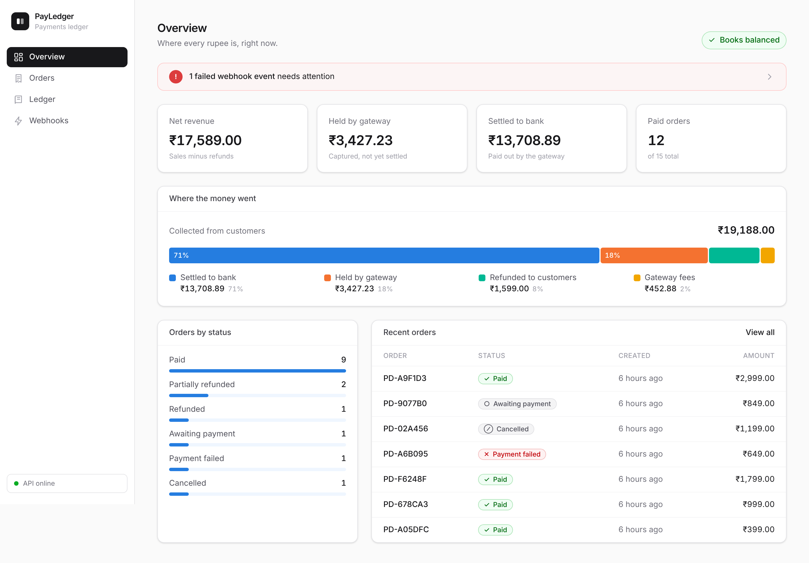
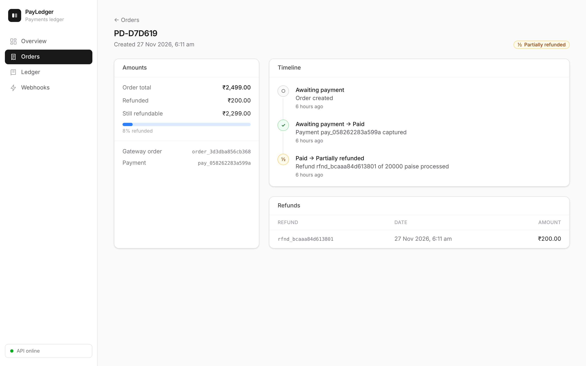
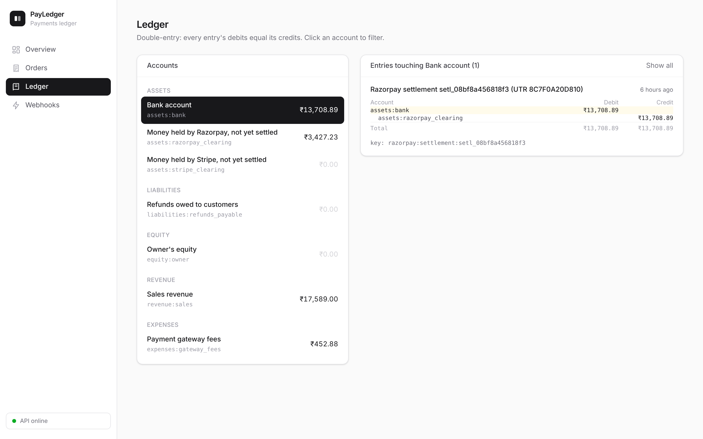

# PayLedger

A double-entry payments ledger for online stores: every rupee is recorded as a
balanced journal entry, payment-gateway webhooks are processed exactly once, and
an AI agent reconciles gateway settlement reports against the books.

> Status: **Ledger core** ✅ · **Razorpay webhooks (exactly-once)** ✅ · **Orders + partial refunds** ✅ · **Dashboard** ✅ · **AI reconciliation** ✅



## Why

When a customer pays ₹1,000 through Razorpay, the gateway keeps a fee, settles the
rest days later, may send the same webhook twice, and refunds can be partial. Naive
code double-counts or loses money. PayLedger makes those bugs structurally impossible.

## Core ideas

- **Double-entry:** every entry's debits equal its credits, so money is only *moved*, never created or lost.
- **Integer paise:** amounts are stored as `BIGINT` paise, never floats.
- **Idempotency keys:** the same business fact (e.g. `razorpay:payment:pay_123`) can never be posted twice.
- **Webhook inbox:** gateways deliver at-least-once. Every webhook is signature-verified (HMAC-SHA256,
  constant-time compare), stored with a unique `(provider, event_id)`, then processed in a single
  transaction with its journal entry. Duplicates are dropped; crashes roll back; a worker retries failures.

```
Razorpay ──► POST /webhooks/razorpay
               │ 1. verify HMAC signature        (reject forgeries → 400)
               │ 2. INSERT webhook_events         (duplicate event id → 200 "duplicate")
               │ 3. BEGIN
               │      post journal entry (idempotency key)
               │      mark event processed
               │    COMMIT                        (crash → rollback → worker retries)
               ▼
            200 OK
```

Example: a ₹1,000 sale with a ₹20 gateway fee:

| Account | Debit | Credit |
|---|---:|---:|
| `assets:razorpay_clearing` | 98,000 | |
| `expenses:gateway_fees` | 2,000 | |
| `revenue:sales` | | 100,000 |

## Orders

```
            ┌──────────► cancelled
  created ──┼──► paid ──► partially_refunded ──► refunded
            ▼     ▲
          failed ─┘  (customer retries payment)
```

- Only whitelisted transitions are allowed; every change is written to an audit trail (`order_events`).
- Webhooks update the order **in the same transaction** as the ledger entry: both happen or neither.
- **Over-refund protection** in three layers: application check, `SELECT … FOR UPDATE` row lock
  (two simultaneous refunds can't both pass), and a DB `CHECK (amount_refunded <= amount)`.
- Edge cases handled: duplicate charges are flagged (not lost), late failures of an old attempt
  can't un-pay a paid order, payments on cancelled orders are rejected for manual review.

## AI reconciliation

Upload Razorpay's settlement report; PayLedger compares every row with the ledger and explains each mismatch.

```
settlement.csv ─► parse (rupees → exact paise, Decimal)
               ─► deterministic matcher        matched · fee mismatch · amount mismatch ·
                  (no AI: money must be exact)  missing in ledger · not yet settled
               ─► Gemini (structured JSON)     cause + explanation + suggested correcting entry
               ─► guardrails (our code)        known accounts · integer paise · debits = credits ·
                                               fix ≤ row amount → otherwise rejected
               ─► human clicks Accept          validate_entry() again → posted to the ledger
```

- **AI where judgment helps, code where correctness matters.** The matcher decides *what* is wrong; the model only explains *why* and proposes a fix.
- **Never trust model output.** Responses are schema-constrained, then re-validated. Tests feed the guardrails unbalanced, oversized, non-integer and made-up-account suggestions; all are rejected.
- **Human in the loop.** Nothing is written to the books until a person accepts it.
- **Minimal data to the model.** Only amounts, IDs and the gateway's note; no customer details.
- **Provider-agnostic.** The `Explainer` protocol makes swapping Gemini for another LLM a one-class change; tests use a fake.

### Evaluation

30 hand-written cases ([`backend/evals`](backend/evals)): fee differences, missed payment/refund webhooks,
chargebacks, gateway credits, pending settlements, amount errors and junk rows. Each answer is scored on cause,
guardrail pass, and whether the journal entry has exactly the right effect per account (or correctly none).

| Model | Correct cause | Correct entry | Fully correct |
|---|---|---|---|
| `gemini-3.5-flash` | 100% | 100% | **30/30** ([results](backend/evals/results/gemini-3.5-flash.md)) |

Caveat: the cases are synthetic and the prompt states the ledger conventions, so this measures reliability on
known patterns. Next: harder ambiguous cases and repeated runs to measure consistency.

```bash
make ai-check   # verify key + model
make eval       # re-run the eval
```

## Dashboard

Next.js 16 (App Router, React Server Components) · TypeScript · Tailwind CSS 4

| Order detail | Ledger |
|---|---|
|  |  |

- **Overview:** live "books balanced" check (total debits vs credits), money held by the gateway vs settled to bank.
- **Orders:** status filters, per-order timeline (audit trail) and refunds.
- **Ledger:** every journal entry shown as debit/credit lines with its idempotency key.
- **Reconciliation:** upload a settlement report, review AI explanations, accept or dismiss each fix.
- **Webhooks:** every stored event, failures highlighted with their error, one-click retry (Server Action).

## Tech stack

**Backend:** FastAPI · SQLAlchemy 2 · PostgreSQL 16 · Alembic · Pydantic · pytest + Hypothesis · Docker · uv
**AI:** Gemini (structured output) behind a provider-agnostic interface · custom eval harness
**Frontend:** Next.js 16 · React 19 · TypeScript · Tailwind CSS 4

## Run it locally

Requirements: Docker Desktop, [uv](https://docs.astral.sh/uv/), Node 20+. Optional: a free
[Gemini API key](https://aistudio.google.com/apikey) in `.env` as `GEMINI_API_KEY` for AI explanations
(matching works without it).

```bash
cp .env.example .env
make db        # start Postgres in Docker
make migrate   # create tables
make seed      # add default accounts
make dev       # API at http://localhost:8000/docs
make demo      # (new tab) fill it with realistic sample data
make web-install && make web   # (new tab) dashboard at http://localhost:3000
make test      # run tests (fast, SQLite)
make test-pg   # run tests on Postgres, including the concurrent-refund race test

# Try webhooks without a Razorpay account (API must be running):
make fake-payment                                                  # signed ₹1,000 payment
cd backend && uv run python scripts/fake_razorpay.py payment --amount 1000 --repeat 3  # duplicates
make retry     # reprocess failed webhook events
```

## Project layout

```
frontend/          # Next.js dashboard (app/ = pages, lib/api.ts = typed API client)
backend/
  app/
    models.py      # tables: accounts, journal_entries, postings
    ledger.py      # validate_entry, post_entry, balances (the core)
    orders.py      # order state machine, refunds, row locking
    api/routes.py  # HTTP endpoints
    seed.py        # default chart of accounts
    webhooks/
      razorpay.py  # signature check + event → journal entry mapping
      inbox.py     # store-then-process, dedup, retries
    recon/         # report parser, matcher, AI explainer + guardrails, sample report
    worker.py      # retries failed webhook events
  evals/           # 30-case AI eval set, scorer, results per model
  scripts/
    fake_razorpay.py  # sends signed test webhooks locally
  migrations/      # Alembic schema migrations
  tests/           # unit, property-based and API tests
```
